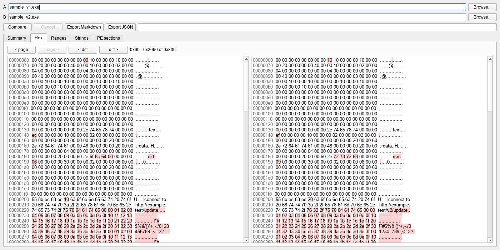

# binary-diff-viewer

Compare two files and see what changed: SHA-256 of each, the changed byte ranges, a side-by-side
hex view with the differing bytes highlighted, a diff of the printable strings, and a section-by-section
comparison when both files are PE images. There is a Qt GUI and a small CLI. Reports export to
Markdown or JSON.

Files are only ever opened for reading and never executed or loaded. The screenshot uses small
synthetic PE files built by the test fixture, not real software.

## Install

Python 3.10+.

    python -m venv .venv
    .venv\Scripts\activate
    pip install -e ".[gui,pe]"

`pe` pulls in `pefile`; without it the PE comparison is skipped. The core and CLI need neither extra.

## Usage

GUI:

    bindiff-gui

Pick two files, hit Compare. The work runs in a background thread, so big files don't freeze the window.
Double-click a row on the Ranges tab to jump to it in the hex view.

CLI:

    bindiff old.bin new.bin
    bindiff old.bin new.bin --markdown report.md --json report.json
    bindiff old.bin new.bin --gui

The exit code is 0 for identical files, 1 if they differ and 2 on errors. Report files are never
overwritten unless you pass `--force`, and an input file can't be used as an output.

## Notes

- Bytes are compared in 1 MiB chunks, so memory stays flat on large files.
- If the files differ in length, the extra bytes at the end count as one changed range (merged with a
  neighbouring range if they touch).
- Only the first 10,000 ranges are kept for display and export; the totals still cover everything.
- Strings are ASCII and UTF-16LE runs of 4+ characters. Only the first 10,000 per file are compared, and
  long ones are cut at 200 characters.

## Limits
- Byte comparison is positional. Insert one byte near the start and everything after it shows as changed;
  there is no alignment step.
- The PE comparison only looks at the entry point, timestamp and section headers/contents. No imports,
  exports or resources.
- The hex view shows one 8 KiB page at a time and highlights by comparing the visible bytes, so it
  is fine on big files but has no search.
- Only run on Windows so far, and only against synthetic PE fixtures. The Linux CI workflow hasn't run yet.

## Development

    pip install -e ".[dev]"
    pytest -q
    ruff check .
    ruff format .

`python scripts/screenshot.py` regenerates the screenshot (set `QT_QPA_FONTDIR` to your fonts folder if
text renders as boxes).

## License

MIT
